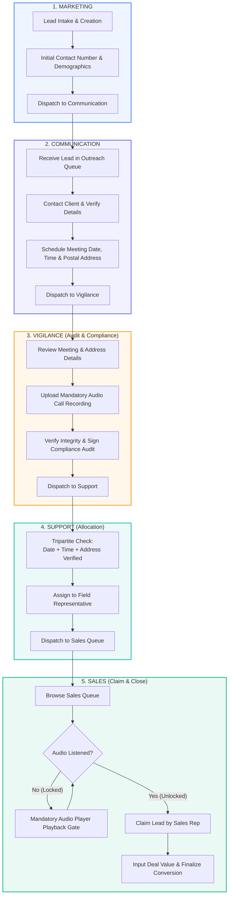
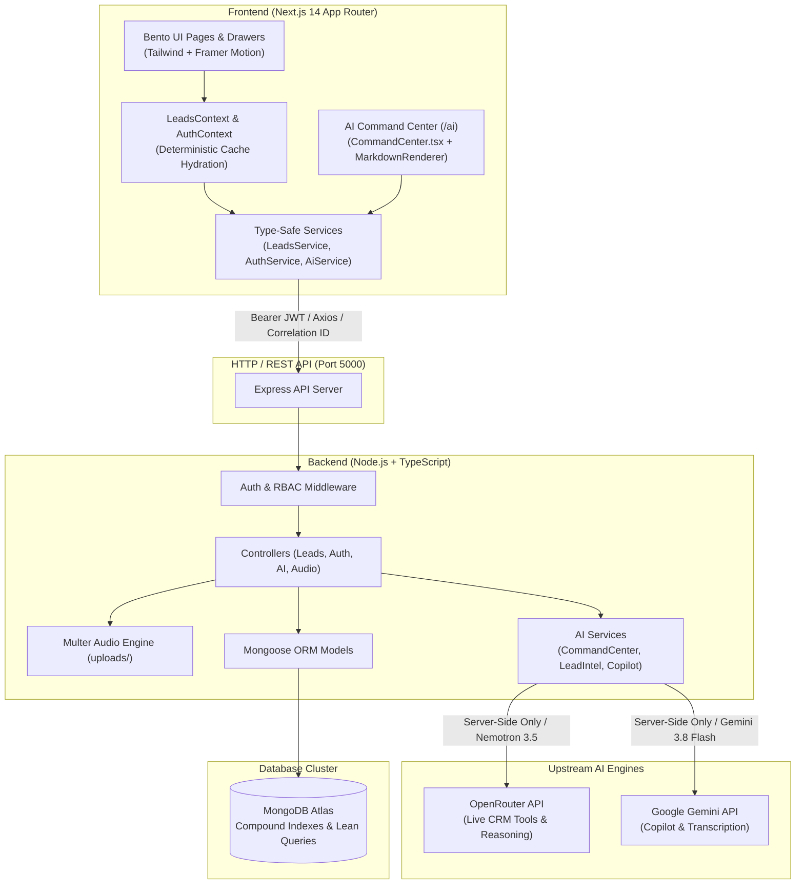

# ⚡ VA Nexus — Venture Automation Nexus | Connect. Automate. Accelerate.

<div align="center">


<br/>

**Enterprise Customer Operations & Lead Lifecycle Platform — enforcing strict sequential progression across 5 specialized departments, backed by a dual-engine AI subsystem (OpenRouter NLP Command Center + Google Gemini Copilots), mandatory audio compliance gating, role-tailored Bento dashboards, and sub-16ms instant-render performance.**

*Tagline: Connect. Automate. Accelerate.*

[Features](#-key-features) • [Workflow](#-sequential-lead-lifecycle) • [Architecture](#-system-architecture) • [RBAC & Demo Credentials](#-role-based-access-control--demo-credentials) • [Folder Structure](#-project-directory-structure) • [Quickstart](#-getting-started) • [API Specs](#-rest-api-overview) • [Testing](#-testing--production-verification)

</div>

---

## 🌟 Executive Overview

**VA Nexus** (*Venture Automation Nexus*) is an enterprise customer operations and lead lifecycle platform designed for zero data slippage and total audit compliance. Unlike generic CRMs where team members can arbitrarily edit or skip lifecycle stages, VA Nexus enforces an **ironclad, sequential 5-stage departmental pipeline**:

$$\text{Marketing} \longrightarrow \text{Communication} \longrightarrow \text{Vigilance} \longrightarrow \text{Support} \longrightarrow \text{Sales (Claim \& Close)}$$

Every transition requires verified data inputs. Crucially, **leads cannot be claimed or closed by Sales without passing through Vigilance's mandatory audio call recording audit**, followed by Support's tripartite address/date/time verification.

The platform is augmented by a **Dual-Engine AI Subsystem**:
1. **OpenRouter AI Command Center (`/ai`)**: A conversational natural-language operations assistant powered by `nvidia/nemotron-3.5-lightning:free`. It autonomously queries 8 live CRM tools scoped strictly to the authenticated user's department, formats rich GitHub-Flavored Markdown (GFM) tables, and features resilient JSON unwrapping and conversation history normalization.
2. **Google Gemini Copilots**: On-demand copilot drawers across departments providing predictive lead conversion scoring (0–100), talking points, automated call transcription, and compliance audit validation.

---

## 🎯 Key Features

### 🏢 1. Ironclad Sequential Lead Progression
- **Marketing Intake**: Lead creation with demographic validation, source attribution, and initial contact records.
- **Communication Outreach**: Contact scheduling, postal address verification, and calendar-backed meeting booking.
- **Vigilance Compliance & Audio Gate**: Meeting review, mandatory upload of recorded phone/audio proof (MP3, WAV, M4A), and compliance sign-off.
- **Support Allocation**: Tripartite verification (Date + Time + Address) before assigning to field agents or executives.
- **Sales Claim & Audio Listener Gate**: Sales representatives are strictly prevented from claiming leads until they have listened to the compliance audio verification recording. Once claimed, deals are negotiated and closed.

### 🤖 2. Dual-Engine AI Subsystem
- **AI Command Center (`/ai`)**:
  - Powered by OpenRouter (`nvidia/nemotron-3.5-lightning:free`) with up to 4096 tokens and internal reasoning integration.
  - **8 Authorized CRM Tools**: Live stage counts, recent leads, stalled lead detection (>3 days), assigned leads, conversion rates, leads by status, Vigilance leads without audio, and Vigilance audio verification summaries.
  - **Strict Department Data Fencing**: Marketing users cannot query Vigilance compliance records; Sales cannot access unallocated leads.
  - **Resilient JSON Unwrapping**: Automatically recovers answers, tools used, suggested follow-ups, and disclaimers even when LLMs output unescaped quotation marks or squashed table rows.
  - **Conversation History Normalization**: Eliminates duplicate consecutive turns and strips redundant trailing user prompts before dispatching to upstream AI providers.
  - **Sanitized Observability**: Structured Pino audit logs with unique correlation IDs (`cid_...`) tracking upstream status, latency, and tool calls with zero leakage of JWTs, API keys, private CRM PII, or internal reasoning thoughts.
- **Departmental Copilot Drawers**:
  - **Sales Copilot**: Objection handling, recommended closing actions, and negotiation talking points.
  - **Vigilance Copilot & Audio Transcription**: Automated multi-speaker dialogue transcription and compliance scoring.
  - **Lead Intelligence**: Explainable predictive win score (0–100) with key risk factors.
  - **Support Copilot**: Verification validation and field assignment guidance.

### 🍱 3. Bento-Style Role-Specific Dashboards
- Workspaces tailored for **6 Distinct Roles**: `ADMIN`, `MARKETING`, `COMMUNICATION`, `VIGILANCE`, `SUPPORT`, and `SALES`.
- High information-density Bento-grid widgets featuring real-time KPIs, workload distributions, department action queues, and chronological audit trails.
- Visual design inspired by **Linear**, **Raycast**, and **Stripe**, offering clean typography, micro-interactions, and visual calm.

### ⚡ 4. Ultra-Fast Data Fetching & Zero Hydration Mismatches
- **Zero Hydration Errors**: Deterministic SSR paired with post-mount cache hydration completely eliminates server-to-client DOM mismatches.
- **Sub-16ms First Meaningful Paint**: Instant warm loads via client-side session caching with background MongoDB Atlas revalidation (`stale-while-revalidate`).
- **Race Condition Prevention**: Monotonic request counters safeguard against out-of-order network responses.
- **MongoDB Atlas Optimization**: High-efficiency compound indexes, lean queries (`.lean()`), and tuned connection pooling.

### 🛡️ 5. Persistent Shell Architecture
- The `<Sidebar />` and `<Header />` live inside a persistent `<AppShell>` that **never unmounts, never blinks, and never shows skeletons** during page transitions or role switches.
- Loading states and skeletons are strictly confined to individual widgets or the main content container via scoped page transitions.

### 🎨 6. Design System & Smooth Motion
- **Precision Easing**: Framer Motion transitions tuned to `cubic-bezier(0.22, 1, 0.36, 1)`.
- **System Theme Support**: Seamless Light / Dark theme switching with a reactive palette and customizable accent colors.
- **Accessible Micro-Interactions**: Role badges, audit status chips, audio waveform controls, and toast notifications powered by `Sonner`.

---

## 🔄 Sequential Lead Lifecycle



---

## 🏗️ System Architecture



---

## 👥 Role-Based Access Control & Demo Credentials

The platform includes seed data with 6 role-tailored user accounts. Use any of the credentials below to test department workflows:

| Role | Demo User | Demo Email | Password | Department Scope & Permissions |
| :--- | :--- | :--- | :--- | :--- |
| **`ADMIN`** | Ananya Sharma | `admin@vibhanu.com` | `VibhAnu@123` | **Full Global Access**: View and orchestrate all 5 departments, configure settings, run executive AI queries, and inspect system audit trails. |
| **`MARKETING`** | Rohan Varma | `marketing@vibhanu.com` | `VibhAnu@123` | **Intake & Discovery**: Create leads, import records, view marketing acquisition metrics. |
| **`COMMUNICATION`** | Pooja Hegde | `communication@vibhanu.com` | `VibhAnu@123` | **Outreach & Scheduling**: Contact prospect, confirm postal address, schedule meeting dates & time slots. |
| **`VIGILANCE`** | Vikram Malhotra | `vigilance@vibhanu.com` | `VibhAnu@123` | **Compliance & Audit**: Verify accuracy, upload mandatory MP3/WAV/M4A call audio recordings, run vigilance transcription copilot. |
| **`SUPPORT`** | Neha Sundaram | `support@vibhanu.com` | `VibhAnu@123` | **Operations & Allocation**: Tripartite verification (Date/Time/Address), field assignment, add operational notes. |
| **`SALES`** | Aditya Deshmukh | `sales@vibhanu.com` | `VibhAnu@123` | **Closing & Conversion**: Listen to compliance audio recording, claim verified leads, use Sales Copilot talking points, close deals. |

> 💡 **Quick Role Switcher**: When logged in, click the role switcher in the top navigation header to instantly jump between departments without logging out.

---

## 💻 Tech Stack

### Frontend
- **Framework**: [Next.js 14.2.15](https://nextjs.org/) (App Router, Server & Client Components)
- **Library**: [React 18.3.1](https://react.dev/)
- **Language**: [TypeScript 5.6.3](https://www.typescriptlang.org/)
- **Styling**: [Tailwind CSS 3.4.14](https://tailwindcss.com/) with CSS variables
- **Motion & Transitions**: [Framer Motion 11.11.9](https://www.framer.com/motion/)
- **Icons**: [Lucide React 0.453.0](https://lucide.dev/)
- **Markdown & Tables**: [ReactMarkdown 10.1](https://github.com/remarkjs/react-markdown) + [remark-gfm 4.0](https://github.com/remarkjs/remark-gfm)
- **Form Management**: [React Hook Form 7.53](https://react-hook-form.com/) + [Zod 3.23](https://zod.dev/)
- **Notifications**: [Sonner 1.5](https://sonner.emilkowal.ski/) toast system

### Backend & AI
- **Runtime & Server**: [Node.js](https://nodejs.org/) + [Express 4.21.1](https://expressjs.com/)
- **Language**: TypeScript with [tsx 4.19](https://github.com/privatenumber/tsx) execution
- **Database**: [MongoDB Atlas](https://www.mongodb.com/atlas) with [Mongoose 8.7.2](https://mongoosejs.com/)
- **AI Command Center**: [OpenRouter API](https://openrouter.ai/) (`nvidia/nemotron-3.5-lightning:free`)
- **AI Copilots & Audio Intelligence**: [Google Gemini API](https://ai.google.dev/) (`@google/genai` 2.31 / `gemini-3.8-flash`)
- **File & Media Handling**: [Multer](https://github.com/expressjs/multer) & [Cloudinary](https://cloudinary.com/)
- **Authentication**: JWT (`jsonwebtoken` 9.0) + `bcryptjs` 2.4
- **Logging**: [Pino 9.5](https://getpino.io/) & `pino-pretty` with sanitized request-correlation IDs

---

## 📁 Project Directory Structure

```plaintext
VibhAnu-CRM/
├── app/                                        # Next.js 14 App Router Pages
│   ├── ai/                                     # AI Command Center & Copilot Portal
│   │   └── page.tsx                            # Command Center interface with role scoping
│   ├── communication/                          # Communication outreach queue & scheduling
│   ├── forgot-password/                        # Password reset flow
│   ├── leads/                                  # Global Lead Directory
│   │   ├── [id]/                               # Comprehensive Lead Detail & Audit view
│   │   └── page.tsx
│   ├── login/                                  # Authentication portal
│   ├── marketing/                              # Marketing intake queue & lead generation
│   ├── sales/                                  # Sales queue with audio gating & claim modal
│   ├── settings/                               # User preferences & theme accents
│   ├── support/                                # Support tripartite allocation queue
│   ├── vigilance/                              # Vigilance queue with audio upload compliance
│   ├── layout.tsx                              # Root layout (Theme, Auth & Leads providers)
│   ├── loading.tsx                             # Scoped non-blocking content loader
│   └── page.tsx                                # Root dynamic Bento dashboard switcher
├── components/                                 # Modular React UI Components
│   ├── ai/                                     # AI Subsystem & Copilot Components
│   │   ├── AiBadge.tsx                         # Status badge for AI-generated insights
│   │   ├── AudioIntelligencePanel.tsx          # Call audio transcription & dialogue viewer
│   │   ├── CommandCenter.tsx                   # Natural Language Command Center chat interface
│   │   ├── LeadInsightPanel.tsx                # Lead predictive score & risk breakdown
│   │   ├── MarkdownRenderer.tsx                # Resilient GFM markdown & table renderer
│   │   ├── SalesCopilot.tsx                    # Sales objection handler & closing drawer
│   │   ├── SupportCopilot.tsx                  # Support allocation assistant
│   │   └── VigilanceCopilot.tsx                # Vigilance compliance & verification auditor
│   ├── dashboard/                              # Role-specific Bento dashboards & metric widgets
│   ├── layout/                                 # Persistent AppShell, Sidebar, Header, PageHeader
│   ├── providers/                              # Theme & context wrapper providers
│   └── ui/                                     # Buttons, Badges, Modals, AudioPlayer, Tables
├── constants/                                  # Client-side roles, status maps & navigation
├── context/                                    # LeadsContext, AuthContext, AccentContext
├── lib/                                        # Shared frontend utility helpers (cn, formatters)
├── public/                                     # Static assets, branding logos & audio samples
├── schemas/                                    # Client-side Zod validation schemas
├── services/                                   # API abstraction layer
│   ├── ai.service.ts                           # AI Command Center & Copilot API client
│   ├── api.ts                                  # Axios instance with auth interceptor
│   ├── auth.service.ts                         # Authentication service
│   ├── leads.service.ts                        # Lead lifecycle service
│   └── mockData.ts                             # Client-side fallback dataset
├── types/                                      # TypeScript interfaces (Leads, Auth, AI, Workflow)
├── backend/                                    # Express + TypeScript Backend
│   ├── src/
│   │   ├── config/                             # Database, OpenRouter, Gemini, Cloudinary & Logger
│   │   │   ├── database.ts                     # MongoDB Mongoose connection
│   │   │   ├── env.ts                          # Strict Zod environment variable parsing
│   │   │   ├── gemini.ts                       # Google Gemini client configuration
│   │   │   ├── logger.ts                       # Pino structured logger with redaction
│   │   │   └── openrouter.ts                   # OpenRouter client configuration & error types
│   │   ├── constants/                          # Department, role, and permission definitions
│   │   ├── controllers/                        # HTTP Request handlers
│   │   │   ├── admin.controller.ts             # User management & audit inspection
│   │   │   ├── ai.controller.ts                # Command center & copilot endpoints
│   │   │   ├── audio.controller.ts             # Compliance audio streaming & verification
│   │   │   ├── auth.controller.ts              # Login, token renewal, session retrieval
│   │   │   ├── dashboard.controller.ts         # Aggregated department statistics
│   │   │   └── lead.controller.ts              # 5-stage sequential transition handlers
│   │   ├── middleware/                         # Security & execution middleware
│   │   │   ├── auth.middleware.ts              # JWT verification & session validation
│   │   │   ├── error.middleware.ts             # Global error handler (429, 502, 504 preservation)
│   │   │   ├── logging.middleware.ts           # HTTP request latency & correlation tracking
│   │   │   ├── rateLimit.middleware.ts         # IP-based rate limiting
│   │   │   ├── requestId.middleware.ts         # Unique X-Request-ID & Correlation ID generator
│   │   │   ├── role.middleware.ts              # RBAC departmental capability guard
│   │   │   ├── upload.middleware.ts            # Multer audio upload parser
│   │   │   └── validate.middleware.ts          # Zod request body/query validator
│   │   ├── models/                             # Mongoose Database Schemas
│   │   │   ├── AiAnalysis.model.ts             # Cached lead intelligence & scoring
│   │   │   ├── AiAuditLog.model.ts             # Audit trail for AI queries & latency
│   │   │   ├── Lead.model.ts                   # Sequential lead schema with compliance fields
│   │   │   └── User.model.ts                   # User schema with roles and departments
│   │   ├── routes/                             # Express REST API routes
│   │   │   ├── admin.routes.ts                 # /api/admin/*
│   │   │   ├── ai.routes.ts                    # /api/ai/*
│   │   │   ├── auth.routes.ts                  # /api/auth/*
│   │   │   ├── dashboard.routes.ts             # /api/dashboard/*
│   │   │   ├── health.routes.ts                # /api/health
│   │   │   ├── index.ts                        # Master router mounting all endpoints
│   │   │   └── lead.routes.ts                  # /api/leads/*
│   │   ├── scripts/                            # Database seeder scripts
│   │   │   └── seed.ts                         # Populates demo users and leads across all stages
│   │   ├── services/                           # Backend Business Logic
│   │   │   └── ai/                             # Dual AI Provider Implementation
│   │   │       ├── ai-audit.service.ts         # Non-blocking AI audit logger
│   │   │       ├── audio-intelligence.service.ts # Call transcription & speaker segmentation
│   │   │       ├── command-center.service.ts   # OpenRouter Command Center & CRM tool orchestrator
│   │   │       ├── gemini.provider.ts          # Resilient Google Gemini client with retry
│   │   │       ├── lead-intelligence.service.ts# Predictive win scoring & risk analysis
│   │   │       ├── openrouter.provider.ts      # OpenRouter client, resilient parser & table normalizer
│   │   │       ├── sales-copilot.service.ts    # Objection handling & sales negotiation generator
│   │   │       ├── support-copilot.service.ts  # Tripartite verification helper
│   │   │       └── vigilance-copilot.service.ts# Compliance verification auditor
│   │   ├── tests/                              # Jest Integration & Regression Test Suite
│   │   │   ├── ai.test.ts                      # AI Command Center, OpenRouter, and parser tests
│   │   │   ├── auth.test.ts                    # JWT validation & session expiry tests
│   │   │   ├── leads.test.ts                   # 5-stage sequential lead lifecycle tests
│   │   │   └── rbac.test.ts                    # Role-based access control tests
│   │   ├── types/                              # Backend TypeScript interfaces
│   │   ├── utils/                              # JWT generation & standard HTTP responses
│   │   ├── validators/                         # Zod request validators
│   │   ├── app.ts                              # Express app configuration & middleware pipeline
│   │   └── server.ts                           # Server listener bootstrap & MongoDB connection
│   ├── uploads/                                # Local fallback directory for compliance audio
│   ├── .env.example                            # Comprehensive environment variable template
│   └── package.json                            # Backend scripts and dependencies
├── package.json                                # Frontend scripts and dependencies
├── tailwind.config.ts                          # Custom colors, shadows & design tokens
└── tsconfig.json                               # TypeScript compiler configuration
```

---

## 🚀 Getting Started

### Prerequisites
- **Node.js**: v18.17.0 or higher (v20+ recommended)
- **npm** or **yarn** / **pnpm**
- **MongoDB Atlas** cluster URI or local MongoDB (`mongodb://127.0.0.1:27017/vibhanu_crm`)
- **OpenRouter API Key** (for AI Command Center — uses free model `nvidia/nemotron-3.5-lightning:free`)
- *(Optional)* **Google Gemini API Key** (for Copilot drawers and audio transcription)

---

### Step 1: Clone & Install Dependencies

```bash
# 1. Clone the repository
git clone https://github.com/your-username/vibh-anu-crm.git
cd vibh-anu-crm

# 2. Install Frontend dependencies
npm install

# 3. Install Backend dependencies
cd backend
npm install
cd ..
```

---

### Step 2: Configure Environment Variables

Create `backend/.env` (you can copy from `backend/.env.example`):

```env
# Server Environment
NODE_ENV=development
PORT=5000

# MongoDB Database URI
MONGO_URI=mongodb://127.0.0.1:27017/vibhanu_crm

# JWT Security
JWT_SECRET=your_super_secret_jwt_key_2026_dev_prod
JWT_EXPIRES_IN=7d

# CORS Allowed Origin
CLIENT_URL=http://localhost:3000

# File Upload Configuration
UPLOAD_DIR=./uploads
MAX_AUDIO_FILE_SIZE=15728640

# OpenRouter AI Configuration (Chatbot Provider; Server-side ONLY)
OPENROUTER_API_KEY=your_openrouter_api_key_here
OPENROUTER_MODEL=nvidia/nemotron-3.5-lightning:free
OPENROUTER_MAX_TOKENS=4096
OPENROUTER_BASE_URL=https://openrouter.ai/api/v1
OPENROUTER_TIMEOUT_MS=35000
OPENROUTER_MAX_RETRIES=2

# Google Gemini AI Configuration (Server-side ONLY; Optional for Copilots)
GEMINI_API_KEY=your_gemini_api_key_here
GEMINI_MODEL=gemini-3.8-flash
GEMINI_TIMEOUT_MS=30000
GEMINI_MAX_RETRIES=3
AI_FEATURES_ENABLED=true
```

*(Optional)* Create `.env.local` in the project root if overriding the frontend API endpoint:
```env
NEXT_PUBLIC_API_URL=http://localhost:5000/api
```

---

### Step 3: Seed the Database with Realistic Demo Data

Populate your MongoDB database with demo users for all 6 roles and realistic leads across all 5 departmental stages:

```bash
npm run seed
```

---

### Step 4: Run the Development Servers

Open two terminal windows:

#### Terminal 1 — Backend API Server
```bash
cd backend
npm run dev
# Server listening on http://localhost:5000
```

#### Terminal 2 — Frontend Application
```bash
npm run dev
# Next.js running on http://localhost:3000
```

Visit **[http://localhost:3000](http://localhost:3000)** in your browser and log in with any of the demo accounts (e.g. `admin@vibhanu.com` / `VibhAnu@123`).

---

## 📡 REST API Overview

### 🔐 Authentication (`/api/auth`)
| Method | Endpoint | Description | Access |
| :--- | :--- | :--- | :--- |
| `POST` | `/api/auth/login` | Authenticate user credentials & issue JWT | Public |
| `GET` | `/api/auth/me` | Fetch active user session profile | Authenticated |
| `POST` | `/api/auth/logout` | Clear session credentials | Authenticated |

### 📋 Lead Lifecycle Progression (`/api/leads`)
| Method | Endpoint | Description | Department / Role Required |
| :--- | :--- | :--- | :--- |
| `GET` | `/api/leads` | Query leads with pagination, search, & department filter | All authenticated |
| `POST` | `/api/leads` | Create new prospect lead in Marketing stage | `MARKETING`, `ADMIN` |
| `GET` | `/api/leads/:id` | Retrieve comprehensive lead profile with full audit log | All authenticated |
| `PATCH` | `/api/leads/:id/communication` | Schedule meeting date, time, and record postal address | `COMMUNICATION`, `ADMIN` |
| `POST` | `/api/leads/:id/vigilance/audio` | Upload mandatory compliance call audio file | `VIGILANCE`, `ADMIN` |
| `PATCH` | `/api/leads/:id/vigilance` | Confirm compliance audit and push to Support | `VIGILANCE`, `ADMIN` |
| `PATCH` | `/api/leads/:id/support` | Validate checklist & allocate field representative | `SUPPORT`, `ADMIN` |
| `POST` | `/api/leads/:id/sales/listen` | Mark mandatory audio playback completed | `SALES`, `ADMIN` |
| `PATCH` | `/api/leads/:id/sales/claim` | Claim lead, record deal value, and close conversion | `SALES`, `ADMIN` |

### 🤖 AI Command Center & Copilots (`/api/ai`)
| Method | Endpoint | Description | Access / RBAC |
| :--- | :--- | :--- | :--- |
| `POST` | `/api/ai/command-center` | Executive natural language CRM queries with live tool execution | All authenticated (data scoped to user role) |
| `GET` | `/api/ai/leads/:id/intelligence` | Predictive win score (0–100) & risk factor analysis | All authenticated |
| `GET` | `/api/ai/leads/:id/sales-copilot` | Sales talking points, objection handling & next steps | `SALES`, `ADMIN` |
| `GET` | `/api/ai/leads/:id/vigilance-copilot`| Compliance audit checklist & audio verification review | `VIGILANCE`, `ADMIN` |
| `GET` | `/api/ai/leads/:id/support-copilot` | Support tripartite check & allocation assistance | `SUPPORT`, `ADMIN` |
| `POST` | `/api/ai/leads/:id/transcribe` | Call audio transcription with speaker dialogue segments | `VIGILANCE`, `ADMIN` |
| `GET` | `/api/ai/health` | Diagnostic probe for OpenRouter & Gemini connectivity | `ADMIN` only |

### 📊 Dashboard & System (`/api/dashboard`, `/api/health`)
| Method | Endpoint | Description | Access |
| :--- | :--- | :--- | :--- |
| `GET` | `/api/dashboard/stats` | Compute aggregated KPIs across all 5 departments | All authenticated |
| `GET` | `/api/health` | Backend and database connectivity health probe | Public |

---

## 🧪 Testing & Production Verification

### Running the Test Suite
The backend contains a full suite of integration and regression tests powered by Jest, Supertest, and `mongodb-memory-server`:

```bash
# Run all backend tests (52 tests across 4 suites)
npm --prefix backend test

# Run AI regression tests specifically
npm --prefix backend test -- ai.test.ts
```

**Test Coverage Highlights:**
- **AI Subsystem**: OpenRouter token exhaustion handling, empty response detection, rate limits (429), timeouts (504), malformed JSON extraction with unescaped internal quotes, squashed table row normalizer, and strict RBAC departmental fencing.
- **Lead Lifecycle**: Complete 5-stage sequential progression from Marketing creation to Sales claim.
- **Audio Verification**: Rejection of verification when audio file is absent; enforcement of audio playback before Sales can claim.
- **Authentication & RBAC**: JWT expiration, malformed token rejection, and route permission enforcement.

### Production Compilation
```bash
# 1. Type check frontend
npx tsc --noEmit

# 2. Build Next.js production bundle
npm run build

# 3. Build backend TypeScript
npm --prefix backend run build
```

---

## 🛡️ Enterprise Security & Compliance

- **Role-Based Guards**: Strict Express middleware validating JWT tokens against role capability bitmaps.
- **Audio Integrity Gate**: Sequential enforcement ensuring sales reps cannot claim leads without auditable verification playback logs.
- **Sanitized Logging**: Pino logging with automatic redaction of JWTs, API keys, private CRM PII, and internal AI reasoning tokens.
- **Error Status Preservation**: Upstream provider status codes (429 Rate Limit, 502 Bad Gateway, 503 Service Unavailable, 504 Timeout) are cleanly preserved and reported back to clients without generic 500 masking.
- **Resilient AI Extraction**: LLM responses with unescaped quotes or formatting quirks are automatically repaired before rendering, ensuring the user always sees clean Markdown.
- **Input Sanitization**: Strong schema enforcement via **Zod** across every API payload.
- **Security Headers & Throttling**: Pre-configured with `helmet`, `cors`, and `express-rate-limit` to prevent brute-force attacks.

---

## 📄 License

This project is licensed under the **MIT License**.

<div align="center">
Built with precision for enterprise reliability, automated compliance, and seamless departmental orchestration.
</div>
