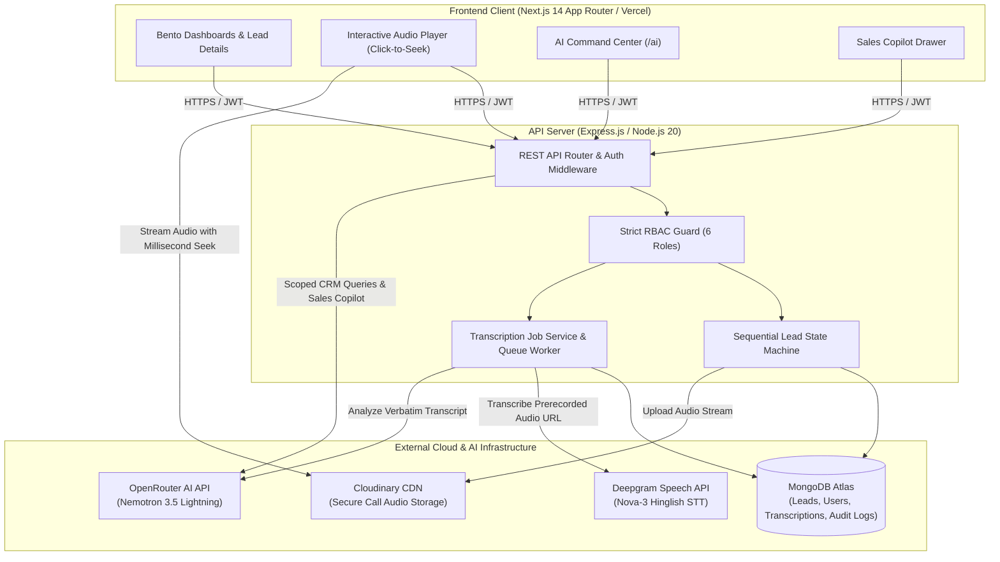

# ⚡ VA Nexus CRM — Enterprise Customer Operations & Lead Lifecycle Platform

<div align="center">


<br/>

**Enterprise Customer Operations & Lead Lifecycle Platform — enforcing strict sequential progression across 6 departments, backed by a production AI subsystem (OpenRouter NLP Command Center + Deepgram Nova-3 Hinglish Speech-to-Text with Diarization), mandatory audio compliance gating, role-tailored Bento dashboards, and sub-16ms instant-render performance.**

*Tagline: Connect. Automate. Accelerate.*

🌐 **Live Deployments:**
- **Frontend Web Application:** [https://va-nexus-crm.vercel.app/](https://va-nexus-crm.vercel.app/)
- **Backend REST API:** [https://vibhanu-crm-backend-pi.vercel.app/](https://vibhanu-crm-backend-pi.vercel.app/)
- **GitHub Repository:** [https://github.com/Aqib1239/VibhAnu-CRM](https://github.com/Aqib1239/VibhAnu-CRM)

[Key Highlights](#-key-highlights) • [6-Stage Pipeline](#-6-stage-lead-pipeline--department-lifecycle) • [RBAC Matrix](#-user-roles--rbac-matrix) • [AI Subsystem](#-ai-subsystem-architecture) • [Architecture](#-system-architecture) • [Tech Stack](#-tech-stack) • [Quickstart](#-getting-started--local-setup) • [API Specs](#-rest-api-reference) • [Testing](#-testing--quality-assurance) • [Security](#-security--compliance)

</div>

---

## 🌟 Executive Overview

**VA Nexus** (*formerly Vibh-Anu CRM*) is a full-stack, enterprise-grade customer operations and lead lifecycle platform engineered for zero data slippage and complete audit compliance. Unlike generic CRMs where team members can arbitrarily edit stages, jump queues, or mark unverified deals as won, VA Nexus enforces an **ironclad, sequential 6-stage departmental pipeline**:

$$\text{Marketing} \longrightarrow \text{Communication} \longrightarrow \text{Vigilance} \longrightarrow \text{Support} \longrightarrow \text{Sales} \longrightarrow \text{Claimed}$$

Every transition requires verified business data inputs. Most critically:
1. **Mandatory Audio Gate**: Leads cannot clear Vigilance or enter Support without a real telephone verification recording uploaded to Cloudinary CDN.
2. **Mandatory 3-Point Checklist Gate**: Support coordinators must verify meeting Date, Time slot, and physical Address before allocating the lead.
3. **Mandatory Audio Listening Gate**: Sales executives cannot claim or close a lead without listening to the recorded verification audio.
4. **Unified Dual-Engine AI Subsystem**:
   - **OpenRouter AI** (`nvidia/nemotron-3.5-lightning:free`): Powers the conversational AI Command Center (`/ai`), on-demand **Sales Copilot**, **Lead Intelligence** scoring, and post-call conversation analysis with zero hallucination constraints and strict RBAC data fencing.
   - **Deepgram Nova-3 Speech-to-Text**: Powers prerecorded call recording transcription with native Hindi + English (Hinglish) code-switching, speaker diarization, word/utterance timestamps, interactive playback seek synchronization, and manual speaker role mapping (`AGENT` vs `CUSTOMER`).

---

## 🎯 Key Highlights

- **Sequential Pipeline Enforcement**: State machine guarantees leads progress strictly through authorized departments in order. Backward jumps or stage bypassing are rejected at both API and database levels.
- **Strict Role-Based Access Control (RBAC)**: 6 distinct system roles (`ADMIN`, `MARKETING`, `COMMUNICATION`, `VIGILANCE`, `SUPPORT`, `SALES`) with granular route guards, UI visibility gates, and department-scoped database queries.
- **Mandatory Audio Compliance Gating**: Vigilance officers upload call recordings; Support coordinators audit audio presence; Sales executives must verify audio before claiming.
- **Deepgram Nova-3 Hinglish Diarization**: High-fidelity prerecorded audio transcription supporting bilingual code-switching, timestamped utterances, confidence scoring, and interactive click-to-seek playback.
- **OpenRouter Executive Sales Copilot**: Generates tailored talking points, objection handling strategies, telephone opening scripts, and editable follow-up message drafts directly from MongoDB CRM records with mandatory human approval gates.
- **OpenRouter Conversational Command Center**: Chatbot interface with 8 live, department-fenced CRM tools, markdown table formatting, internal reasoning stripping, and conversation history deduplication.
- **Enterprise Observability & Auditability**: Every workflow mutation appends an immutable timeline event to the lead's history; every AI generation logs a structured `AiAuditLog` entry with correlation IDs, latency tracking, and role scoping.
- **Sub-16ms Instant-Render UI**: Bento-style dashboards inspired by Linear and Raycast, built with Tailwind CSS, Framer Motion, persistent `<AppShell>`, and zero hydration mismatches.

---

## 🔄 6-Stage Lead Pipeline & Department Lifecycle

```mermaid
flowchart LR
    A["1. MARKETING<br/>Intake & Inbound"] -->|"Demographics Verified"| B["2. COMMUNICATION<br/>Outreach & Booking"]
    B -->|"Date, Time & Address Set"| C["3. VIGILANCE<br/>Audio Verification Gate"]
    C -->|"Audio Uploaded & Signed"| D["4. SUPPORT<br/>3-Point Checklist & Queue"]
    D -->|"3-Point Checked & Allocated"| E["5. SALES<br/>Listen & Negotiate"]
    E -->|"Deal Won / Closed"| F["6. CLAIMED<br/>Revenue & Audit Log"]
```



### Detailed Departmental Workflow Breakdown

| Stage | Department | Allowed Actions & Gates | Required Input Data | Target Status |
|---|---|---|---|---|
| **1** | **Marketing** | Lead intake, initial qualification, demographic entry. Cannot schedule meetings or upload audio. | `leadCode`, `name`, `contactNumber`, `city`, `state`, `remark` | `in_progress` |
| **2** | **Communication** | Customer outreach, appointment scheduling, site address verification. | `date`, `time`, `postalAddress`, `meetingNotes` | `meeting_scheduled` |
| **3** | **Vigilance** | Compliance audit & **Mandatory Audio Upload Gate**. Cannot progress without uploading call audio (MP3/WAV/M4A) to Cloudinary CDN. Deepgram transcription enabled. | Call audio recording file, `verificationNotes` | `verified` |
| **4** | **Support** | **3-Point Checklist Gate**: Verifies Date, Time, and Address. Confirms audio presence. Allocates lead to qualified sales executive. | `isDateVerified`, `isTimeVerified`, `isAddressVerified`, `allocatedTo`, `allocationNotes` | `allocated` |
| **5** | **Sales** | **Audio Listener Gate**: Sales executive must listen to call audio before claiming. Generates Sales Copilot collateral, negotiates, and records deal outcome. | `audioListenCompleted: true`, `dealValue`, `dealNotes`, `closingReason` | `claimed` / `lost` |
| **6** | **Claimed** | Final closed revenue state. Archived in historical reporting with complete immutable audit timeline. | Closed deal records & timestamped transition events | `claimed` |

---

## 👥 User Roles & RBAC Matrix

VA Nexus enforces least-privilege role-based access control across all frontend views and backend API routes.

| Permission / Capability | `ADMIN` | `MARKETING` | `COMMUNICATION` | `VIGILANCE` | `SUPPORT` | `SALES` |
|---|:---:|:---:|:---:|:---:|:---:|:---:|
| **Create Inbound Leads** | ✅ | ✅ | ❌ | ❌ | ❌ | ❌ |
| **Schedule Customer Meetings** | ✅ | ❌ | ✅ | ❌ | ❌ | ❌ |
| **Upload Call Audio Recordings** | ✅ | ❌ | ❌ | ✅ | ❌ | ❌ |
| **Perform Vigilance Compliance Audit** | ✅ | ❌ | ❌ | ✅ | ❌ | ❌ |
| **Trigger Deepgram Audio Transcription** | ✅ | ❌ | ❌ | ✅ | ✅ | ✅ |
| **Edit Diarization Speaker Roles** | ✅ | ❌ | ❌ | ✅ | ✅ | ✅ |
| **Perform 3-Point Support Allocation** | ✅ | ❌ | ❌ | ❌ | ✅ | ❌ |
| **Listen to Verification Audio** | ✅ | ❌ | ❌ | ✅ | ✅ | ✅ |
| **Claim Lead & Record Deal Outcome** | ✅ | ❌ | ❌ | ❌ | ❌ | ✅ |
| **Generate Sales Copilot Collateral** | ✅ | ❌ | ❌ | ❌ | ❌ | ✅ |
| **Access AI Command Center Chatbot** | ✅ *(All Data)* | ✅ *(Mktg Only)* | ✅ *(Comm Only)* | ✅ *(Vig Only)* | ✅ *(Supp Only)* | ✅ *(Sales Only)* |
| **View System Audit & AI Audit Logs** | ✅ | ❌ | ❌ | ❌ | ❌ | ❌ |
| **User & Account Management** | ✅ | ❌ | ❌ | ❌ | ❌ | ❌ |

---

## 🤖 AI Subsystem Architecture

VA Nexus features a clean, provider-isolated architecture where all heavy AI synthesis and speech processing occur server-side.

### 1. OpenRouter AI Engine
- **Provider & Model**: [OpenRouter API](https://openrouter.ai/) running `nvidia/nemotron-3.5-lightning:free` (configurable via `OPENROUTER_MODEL`).
- **Shared AI Service Layer**: Both the Command Center chatbot and the departmental copilots share a single resilient client (`openrouter.provider.ts`) featuring:
  - **Bounded Exponential Backoff**: Auto-retries for transient 5xx errors with jitter; fail-fast handling for auth, quota (429), or credit limits.
  - **Chain-of-Thought Stripping**: Automatically purges `<thought>`, `<think>`, and reasoning wrappers before returning answers to client interfaces.
  - **Resilient JSON Unwrapping**: Robust extraction logic that recovers structured answers, tools, follow-ups, and disclaimers even when LLMs produce unescaped internal quotes or markdown formatting.
  - **Conversation History Normalization**: Strips duplicate consecutive prompts and maps client turns cleanly to provider chat completion schemas.
- **Features Powered by OpenRouter**:
  - **Command Center Chatbot (`/ai`)**: Natural language queries over 8 authorized CRM tools (stalled leads, stage counts, audio compliance breakdowns, conversion metrics).
  - **Lead Details → Sales Copilot**: Generates tailored key talking points, objection handling counter-arguments, custom opening call scripts, personalized follow-up message drafts, and next best actions grounded strictly in verified lead data. Includes a mandatory **Human Review Gate** (`requiresApproval: true`).
  - **Lead Intelligence Scoring**: Explainable predictive win score (0–100) combining heuristic CRM factors (inactivity days, stage velocity, audio presence) with AI synthesis.
  - **Vigilance & Support Copilots**: Advisory checklists with automated deterministic fallback engines.
  - **Post-Transcription Call Insights**: Analyzes completed Deepgram transcripts to extract customer objections, commitments, purchase intent, and agent communication quality.

### 2. Deepgram Nova-3 Speech-to-Text Engine
- **Provider & Model**: [Deepgram SDK](https://deepgram.com/) (`@deepgram/sdk` 5.17) running model `nova-3` with multi-language code-switching (`language: "multi"`).
- **Core Capabilities**:
  - **Hindi + English (Hinglish) Support**: Native handling of Indian enterprise code-switching without forced translation.
  - **Speaker Diarization**: Separates conversation turns using `diarize_model: "latest"` and assigns speaker indices.
  - **Word & Utterance Timestamps**: High-precision start/end offsets enable interactive click-to-seek playback in the custom audio player.
  - **Confidence & Paragraph Formatting**: Preserves punctuation, paragraph structure, and utterance-level confidence metrics.
  - **Asynchronous Processing Queue**: MongoDB-backed persistent job model (`Transcription.model.ts`) with atomic worker claiming, automatic retries, and stale job recovery.
  - **Speaker Role Mapping**: Allows coordinators to map numeric speakers (`Speaker 0`, `Speaker 1`) to business roles (`AGENT`, `CUSTOMER`) with persistent audit tracking.

---

## 🏛️ System Architecture



---

## 💻 Tech Stack

### Frontend Application
- **Framework**: [Next.js 14](https://nextjs.org/) (App Router, React 18, Server & Client Components)
- **Styling**: [Tailwind CSS 3.4](https://tailwindcss.com/) with Neumorphic and Linear-inspired design tokens
- **Animations**: [Framer Motion 11](https://www.framer.com/motion/) (`cubic-bezier(0.22, 1, 0.36, 1)`)
- **Icons**: [Lucide React](https://lucide.dev/)
- **Forms & Validation**: `react-hook-form` with `zod` resolvers
- **Notifications**: `sonner` toast notification system
- **Markdown Rendering**: `react-markdown` with `remark-gfm` for tables and checklists

### Backend REST API
- **Runtime**: [Node.js 20 LTS](https://nodejs.org/)
- **Framework**: [Express.js 4.21](https://expressjs.com/) with TypeScript 5.6
- **Database ORM**: [Mongoose 8.7](https://mongoosejs.com/) for MongoDB Atlas
- **Authentication**: Stateless JSON Web Tokens (`jsonwebtoken`) with `bcryptjs` password hashing
- **File Uploads**: `multer` with `multer-storage-cloudinary`
- **Structured Logging**: [Pino 9.5](https://getpino.io/) with `pino-pretty` for sanitization and correlation IDs
- **Security Middleware**: `helmet`, `cors`, `express-rate-limit`

### AI & Media Services
- **Conversational AI & Copilots**: [OpenRouter API](https://openrouter.ai/) (`nvidia/nemotron-3.5-lightning:free`)
- **Speech-to-Text & Diarization**: [Deepgram SDK](https://deepgram.com/) (`@deepgram/sdk` 5.17, `nova-3`, `language: multi`)
- **Audio CDN Storage**: [Cloudinary](https://cloudinary.com/) (MP3, WAV, M4A streaming)

### Testing & Infrastructure
- **Unit & Integration Testing**: [Jest 29](https://jestjs.io/) with `ts-jest` and `supertest`
- **In-Memory Testing DB**: `mongodb-memory-server`
- **Hosting & Deployments**: [Vercel](https://vercel.com/) (Frontend & Backend Serverless Instances)

---

## 🚀 Getting Started & Local Setup

### Prerequisites
- **Node.js**: `v18.18.0` or higher (Node 20 LTS recommended)
- **npm**: `v9.0.0` or higher
- **MongoDB**: Local MongoDB instance (`mongodb://localhost:27017/vibhanu_crm`) or MongoDB Atlas URI
- **Cloudinary Account**: Cloud name, API key, and secret for audio storage
- **OpenRouter Account**: API key for chatbot and copilots
- **Deepgram Account**: API key for speech-to-text transcription

### Step 1: Clone the Repository
```bash
git clone https://github.com/Aqib1239/VibhAnu-CRM.git
cd VibhAnu-CRM
```

### Step 2: Install Dependencies
Install dependencies for both root (frontend) and backend workspaces:
```bash
# Install frontend dependencies
npm install

# Install backend dependencies
npm --prefix backend install
```

### Step 3: Configure Environment Variables

#### Frontend Environment (`.env.local` in root directory)
```env
NEXT_PUBLIC_API_URL=http://localhost:5000/api
```

#### Backend Environment (`backend/.env` in `backend/` directory)
```env
# Server Configuration
NODE_ENV=development
PORT=5000
MONGO_URI=mongodb://127.0.0.1:27017/vibhanu_crm
JWT_SECRET=your_super_secure_jwt_secret_key_dev_2026
JWT_EXPIRES_IN=7d
CLIENT_URL=http://localhost:3000
UPLOAD_DIR=./uploads
MAX_AUDIO_FILE_SIZE=15728640

# Cloudinary Audio Storage
CLOUDINARY_CLOUD_NAME=your_cloudinary_cloud_name
CLOUDINARY_API_KEY=your_cloudinary_api_key
CLOUDINARY_API_SECRET=your_cloudinary_api_secret

# OpenRouter AI Subsystem (Chatbot & Copilots)
OPENROUTER_API_KEY=sk-or-v1-your_openrouter_api_key_here
OPENROUTER_MODEL=nvidia/nemotron-3.5-lightning:free
OPENROUTER_BASE_URL=https://openrouter.ai/api/v1
OPENROUTER_TIMEOUT_MS=35000
OPENROUTER_MAX_RETRIES=2
AI_FEATURES_ENABLED=true
AI_MONTHLY_BUDGET_USD=50

# Deepgram Speech-to-Text (Nova-3 Hinglish STT)
DEEPGRAM_API_KEY=your_deepgram_api_key_here
DEEPGRAM_MODEL=nova-3
DEEPGRAM_LANGUAGE=multi
```

### Step 4: Seed the Database
Populate MongoDB with default demo users for all 6 roles and realistic sample leads:
```bash
npm run seed
# or: npm --prefix backend run seed
```

### Step 5: Run the Development Servers
Open two terminal windows:

**Terminal 1 (Backend API on Port 5000):**
```bash
npm --prefix backend run dev
```

**Terminal 2 (Frontend App on Port 3000):**
```bash
npm run dev
```

Open [http://localhost:3000](http://localhost:3000) in your browser.

---

## 🔑 Demo Credentials

All seed accounts are initialized with the default password: **`VibhAnu@123`**

| Role | Email Address | Assigned Department | Default View |
|---|---|---|---|
| **ADMIN** | `admin@vibhanu.com` | Executive Management | `/` (Full Operations Dashboard) |
| **MARKETING** | `marketing@vibhanu.com` | Growth & Acquisition | `/marketing` (Lead Intake) |
| **COMMUNICATION** | `communication@vibhanu.com` | Customer Outreach | `/communication` (Meeting Scheduling) |
| **VIGILANCE** | `vigilance@vibhanu.com` | Compliance & Vigilance | `/vigilance` (Audio Verification Gate) |
| **SUPPORT** | `support@vibhanu.com` | Operations & Support | `/support` (3-Point Allocation Queue) |
| **SALES** | `sales@vibhanu.com` | Enterprise Sales | `/sales` (Audio Listener & Deal Closing) |

---

## 📡 REST API Reference

Base URL prefix: `/api`

### 1. Authentication Routes (`/api/auth`)
| Method | Endpoint | Description | Auth Required | Allowed Roles |
|---|---|---|:---:|---|
| `POST` | `/api/auth/register` | Register a new user account | Yes | `ADMIN` only |
| `POST` | `/api/auth/login` | Authenticate user & return JWT token | No | Public |
| `GET` | `/api/auth/me` | Retrieve profile of authenticated user | Yes | All authenticated |
| `POST` | `/api/auth/logout` | Invalidate user session | Yes | All authenticated |

### 2. Lead Management Routes (`/api/leads`)
| Method | Endpoint | Description | Auth Required | Allowed Roles |
|---|---|---|:---:|---|
| `GET` | `/api/leads` | List all leads (scoped by user role/dept) | Yes | All authenticated |
| `GET` | `/api/leads/stats` | Pipeline metrics and stage distributions | Yes | All authenticated |
| `GET` | `/api/leads/queue/:dept` | Leads pending action in department queue | Yes | Department role or `ADMIN` |
| `GET` | `/api/leads/:id` | Get full lead profile with workflow history | Yes | All authenticated |
| `POST` | `/api/leads` | Create new inbound lead | Yes | `MARKETING`, `ADMIN` |
| `PUT` | `/api/leads/:id` | Update lead general fields | Yes | All authenticated (scoped) |
| `POST` | `/api/leads/:id/meeting` | Confirm meeting date, time & address | Yes | `COMMUNICATION`, `ADMIN` |
| `POST` | `/api/leads/:id/audio` | Upload call recording (Cloudinary CDN) | Yes | `VIGILANCE`, `ADMIN` |
| `POST` | `/api/leads/:id/verify` | Complete Vigilance audit (Requires Audio) | Yes | `VIGILANCE`, `ADMIN` |
| `POST` | `/api/leads/:id/allocate` | Complete 3-point checklist & allocate | Yes | `SUPPORT`, `ADMIN` |
| `POST` | `/api/leads/:id/claim` | Claim lead (Requires Audio Listen) | Yes | `SALES`, `ADMIN` |
| `POST` | `/api/leads/:id/close` | Record deal closing (Won/Lost + Value) | Yes | `SALES`, `ADMIN` |
| `DELETE` | `/api/leads/:id` | Soft or hard delete lead record | Yes | `ADMIN` only |

### 3. Speech-to-Text Transcription Routes (`/api/transcription`)
| Method | Endpoint | Description | Auth Required | Allowed Roles |
|---|---|---|:---:|---|
| `POST` | `/api/transcription/leads/:leadId/start` | Start Deepgram Nova-3 transcription job | Yes | `VIGILANCE`, `SUPPORT`, `SALES`, `ADMIN` |
| `GET` | `/api/transcription/leads/:leadId` | Get transcription status, utterances & diarization | Yes | `VIGILANCE`, `SUPPORT`, `SALES`, `ADMIN` |
| `POST` | `/api/transcription/leads/:leadId/retry` | Re-queue failed transcription job | Yes | `VIGILANCE`, `SUPPORT`, `SALES`, `ADMIN` |
| `PUT` | `/api/transcription/leads/:leadId/speakers` | Update speaker role mappings (`AGENT` / `CUSTOMER`) | Yes | `VIGILANCE`, `SUPPORT`, `SALES`, `ADMIN` |
| `POST` | `/api/transcription/leads/:leadId/analyze` | Run OpenRouter post-transcription call analysis | Yes | `VIGILANCE`, `SUPPORT`, `SALES`, `ADMIN` |

### 4. AI Subsystem & Copilot Routes (`/api/ai`)
| Method | Endpoint | Description | Auth Required | Allowed Roles |
|---|---|---|:---:|---|
| `GET` | `/api/ai/health` | Diagnostic probe for OpenRouter status (No secrets) | Yes | `ADMIN` only |
| `POST` | `/api/ai/command-center` | Chatbot query with 8 RBAC-scoped CRM tools | Yes | All authenticated |
| `GET` | `/api/ai/leads/:id/intelligence` | Explainable lead conversion scoring (0–100) | Yes | All authenticated |
| `GET` | `/api/ai/leads/:id/sales-copilot` | Executive sales collateral & talking points | Yes | `SALES`, `ADMIN` |
| `GET` | `/api/ai/leads/:id/vigilance-copilot` | Compliance verification audit copilot | Yes | `VIGILANCE`, `ADMIN` |
| `GET` | `/api/ai/leads/:id/support-copilot` | 3-point checklist allocation copilot | Yes | `SUPPORT`, `ADMIN` |
| `GET` | `/api/ai/audit-logs` | Chronological audit logs of all AI operations | Yes | `ADMIN` only |

### 5. Administration Routes (`/api/admin`)
| Method | Endpoint | Description | Auth Required | Allowed Roles |
|---|---|---|:---:|---|
| `GET` | `/api/admin/users` | List all users across departments | Yes | `ADMIN` only |
| `POST` | `/api/admin/users` | Create new staff user account | Yes | `ADMIN` only |
| `PUT` | `/api/admin/users/:id` | Update user status, role, or department | Yes | `ADMIN` only |
| `DELETE` | `/api/admin/users/:id` | Deactivate staff user account | Yes | `ADMIN` only |
| `GET` | `/api/admin/metrics` | System-wide operational KPIs | Yes | `ADMIN` only |

---

## 🧪 Testing & Quality Assurance

VA Nexus includes an extensive automated test suite covering authentication, lead state progression, strict RBAC authorization, OpenRouter integration resilience, and Deepgram transcription jobs.

```bash
# Run backend test suite (in-memory MongoDB)
npm --prefix backend test
```

### Verified Test Results
```
Test Suites: 5 passed, 5 total
Tests:       63 passed, 63 total
Snapshots:   0 total
Time:        ~56 s
```

- **`auth.test.ts`**: Password hashing, secure login, invalid credentials, JWT extraction, authenticated profile lookup.
- **`leads.test.ts`**: Full sequential lifecycle simulation from Marketing intake to Sales closing, enforcing every gate condition.
- **`rbac.test.ts`**: Cross-department permission tests verifying unauthorized operations return HTTP `403 Forbidden`.
- **`transcription.test.ts`**: Deepgram Nova-3 job lifecycle, atomic worker claims, timeout recovery, speaker role updates, and OpenRouter transcript analysis.
- **`ai.test.ts`**: OpenRouter Command Center, Sales Copilot generation, history normalization, internal thought stripping, token limit handling, malformed JSON recovery, and AI audit logging.

---

## 🔒 Security & Compliance

- **Stateless Authentication**: Cryptographically signed JWT tokens with expiration policies; passwords salted and hashed using `bcryptjs` (cost factor 10).
- **Zero Client Secret Exposure**: `OPENROUTER_API_KEY`, `DEEPGRAM_API_KEY`, and Cloudinary API secrets exist solely in backend environment files and are **never** prefixed with `NEXT_PUBLIC_` or returned in API responses.
- **Mandatory Human Verification**: All AI-generated outputs (Sales Copilot scripts, follow-up emails, compliance assessments) enforce `requiresApproval: true` or `mandatoryHumanVerificationRequired: true`. The CRM explicitly forbids automated outreach without human sign-off.
- **Strict Data Fencing & RBAC**: Database queries in controllers and AI tools are filtered by `req.user.department` and `req.user.role`. Marketing agents cannot query compliance evidence; Sales reps cannot view unverified leads.
- **Sanitized Logging**: Pino logging middleware automatically filters out password fields, authorization headers, and raw audio buffers. Every log entry includes a unique `requestId` and correlation ID.
- **Audit Logging**: All lifecycle state transitions are permanently stored in the lead's `workflowHistory` array with actor ID, timestamp, and action description. All AI generations are recorded in the `AiAuditLog` collection.

---

## 📄 License & Attribution

This project is licensed under the **MIT License**.

Built with precision for enterprise customer operations by the **VA Nexus Core Engineering Team**.
For questions or architectural inquiries, contact `aditya@vibhanu.com` or open an issue on [GitHub](https://github.com/Aqib1239/VibhAnu-CRM).
